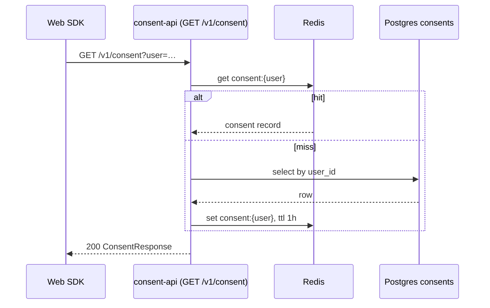
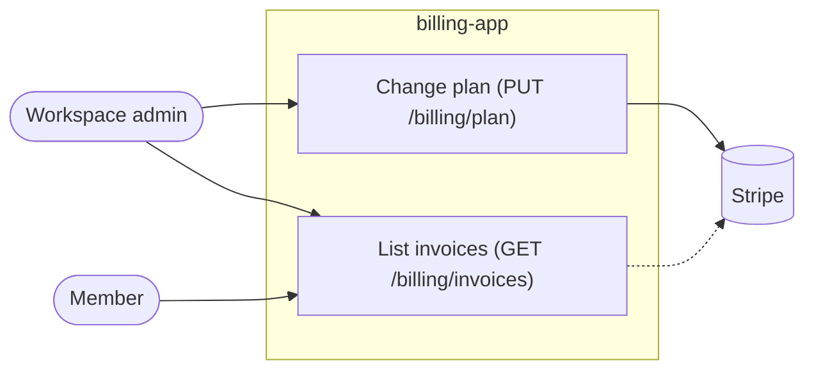
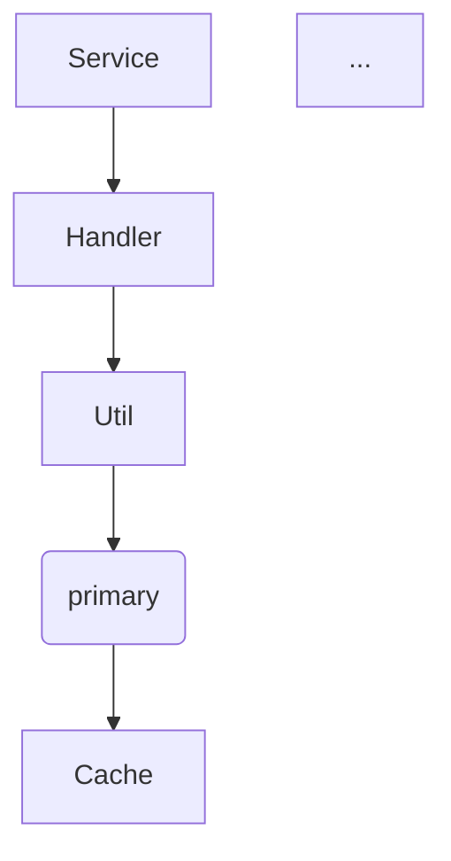
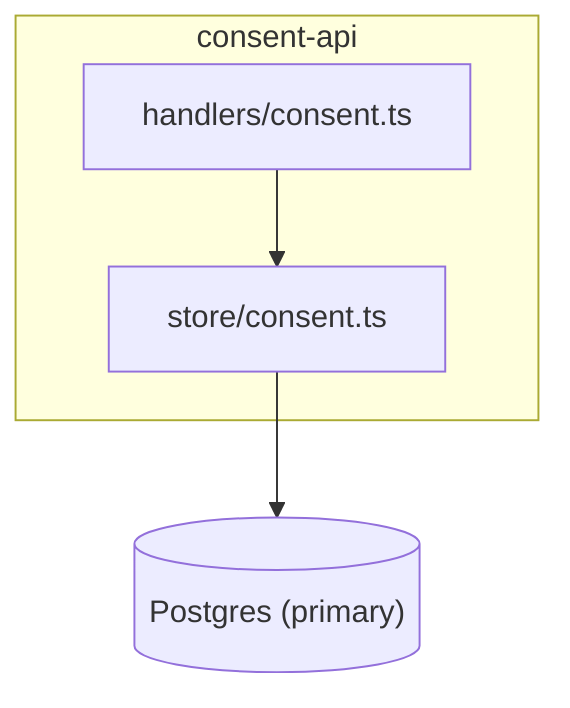

# Mermaid

Mermaid is the default because GitHub, GitLab and most doc sites render a fenced ```` ```mermaid ```` block as is, the source diffs in review, and a refresh can redraw it without a tool.
The lint step parses every block with the pinned `maid` linter, which catches syntax errors. The rules below also keep a block legible, which no parser checks.

## Rules

| Rule | Why |
|---|---|
| At most 12 nodes or 10 messages per block; split into two blocks or a series past that | A bigger picture stops being read |
| Every node is a real file, module, service, table, actor or state; its label says which | A box named "Service" shows nothing |
| Quote any label with `(`, `)`, `[`, `]`, `{`, `}`, `:`, `;`, `"`, `#`, `<`, `>`, a pipe, or a leading number: `A["login (POST /auth)"]` | Unquoted punctuation is the first thing that breaks a render |
| Node ids are `[A-Za-z0-9_]` only, never the label | `end`, `graph`, `subgraph` and punctuation in an id break the parse |
| One edge label per edge, under five words: `A -->\|"session cookie"\| B` | Long labels wrap into the boxes |
| Group a boundary with `subgraph id ["Label"] ... end`, never with colours | `style` and `classDef` render differently per host and say nothing a label cannot |
| A dashed edge (`-.->`, `-->>` in sequence) means "not verified in this session"; list those under the block | Readers must see what was inferred |
| No `%%{init ...}%%`, `click`, `linkStyle`, `htmlLabels` or `<br/>` | They depend on the renderer's config |
| Use `stateDiagram-v2`, never `stateDiagram` | v1 is legacy |
| `direction` goes inside a subgraph only when its flow differs from the parent | Mixed directions without a reason look like a mistake |

## The marker

Every block is wrapped, with the three attributes read from the investigation and `sha` set by the stamp script:

````markdown
<!-- diagram name=<unique-slug> kind=<kind> sha=0000000 paths=<pathspec>[,<pathspec>] -->
```mermaid
...
```
<!-- /diagram -->
````

Write `sha=0000000` when drafting, then run `stamp <name>`; a hand-typed sha is a guess.
`paths` has no spaces; quote the whole value when a path contains a comma.
A tutorial series is several markers, named `<slug>-1`, `<slug>-2`, each anchored to the same paths.

## Examples

### Happy path: an explanation of a request

````markdown
<!-- diagram name=consent-read kind=explanation sha=3f9c2a1 paths=src/api/consent/**,src/store/consent.ts -->

<!-- /diagram -->
````

Each participant names the real process or file, the branch is the one the code has, and the paths cover the handler and the store it reads.

### Robust variant: punctuation, a boundary, an inference

````markdown
<!-- diagram name=billing-boundary kind=use-case sha=8ab12cd paths=src/routes/**,src/auth/** -->

<!-- /diagram -->

Not verified: whether invoice listing reads Stripe or the local mirror (`src/billing/invoices.ts` was not opened).
````

Labels with parentheses are quoted, ids are plain words, the dashed edge is declared under the block.

### Anti-pattern, then the correction

Wrong: one flowchart with twenty nodes, generic names and an unquoted label.



`DB(primary)` fails to parse, "Service" and "Util" tell the reader nothing, and twenty nodes in one block is a map nobody follows.

Right: split by the question the reader has, name the parts, quote the label.



Then a second block for the cache path, and a third for the write path, each its own marker.
